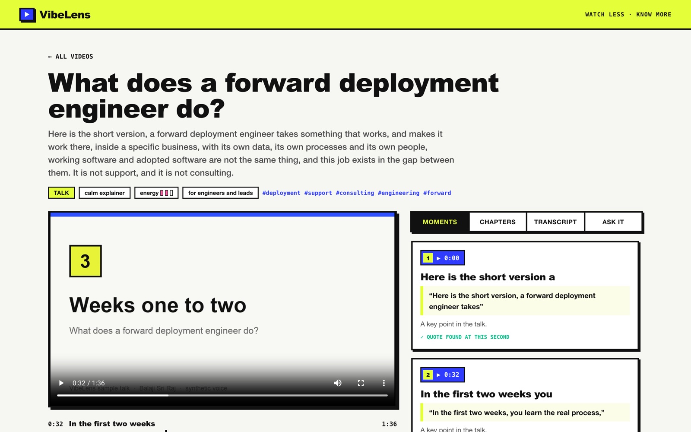
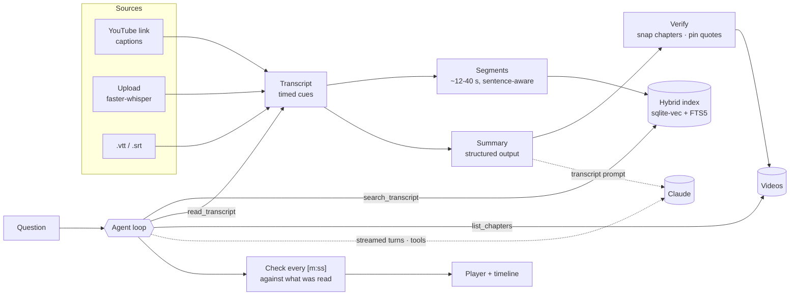

# VibeLens

**Watch less. Know more.**

https://github.com/user-attachments/assets/ebdead8a-4611-4699-8903-3da0c78c1659

<sub>▶ The film, with sound (1 min 42 s). <a href="#the-film">How it was made</a>.</sub>

Paste a YouTube link or drop in your own video, audio or caption file. VibeLens produces:
- a transcript
- chapters on a scrubbable timeline
- the moments worth jumping to, each pinned to the exact second its quote is said
- a vibe check: format, tone, energy and audience

Then ask it anything. A tool-using agent searches the tape before it answers, and every timestamp in the answer is a button that seeks the player.

## What it shows

| | |
|---|---|
| **Tool-using agent** | Claude decides when to call `search_transcript`, `read_transcript` and `list_chapters`, in a bounded loop with streamed tokens and validated tool inputs |
| **Citations to the second** | Every timestamp the agent cites is checked against the transcript ranges it actually read. A time it never looked at is flagged in the UI |
| **Grounded summaries** | Chapter starts snap to real transcript lines, and each key moment is pinned to where its quote is spoken, matched across caption line breaks |
| **Three ingest paths** | YouTube captions, local speech recognition with faster-whisper for uploads, or a `.vtt` / `.srt` file. All feed one linear pipeline |
| **Hybrid search** | Segments indexed with fastembed vectors (sqlite-vec) and BM25 (FTS5), merged with reciprocal rank fusion |
| **Product design** | A neo-brutalist editing-studio UI: chapter timeline with moment pins, live-synced transcript, tool trace in the chat |



## Architecture



**A pipeline, not a graph.** Ingest never branches, so it's four plain async stages that each report progress over SSE. The interesting control flow lives in the chat. There the model, not the code, decides what to look up next, and the code bounds it: at most five tool steps, inputs validated with Pydantic, errors returned to the model as `is_error` results.

The three Lab products so far each use a different orchestration on purpose:

| Product | Orchestration |
|---|---|
| [Ashariri](https://github.com/balajisriraj/ashariri) | A routed state machine with a review loop |
| [PaperSensei](https://github.com/balajisriraj/paper-sensei) | A map-reduce fan-out |
| VibeLens | A linear pipeline plus a tool-using agent |

More detail is in [docs/architecture.md](docs/architecture.md).

## Run it

**No API key needed.** The scripted model summarises and answers from the transcript itself:

```bash
cd backend
uv sync
VIBELENS_LLM=scripted VIBELENS_SCRIPTED_DELAY=0.03 uv run vibelens serve   # API on :8000
cd ../frontend && pnpm install && pnpm dev                                  # UI on :5173
```

**With Claude:**

```bash
export ANTHROPIC_API_KEY=sk-ant-...
cd backend && uv run vibelens serve
```

**Docker:** `cp .env.example .env && docker compose up --build`, then open http://localhost:8080.

**Terminal:**

```bash
uv run vibelens watch https://www.youtube.com/watch?v=...   # or a local file, or nothing for the sample
uv run vibelens ask <video-id> "What happens in the first two weeks?"
uv run vibelens eval --verbose
```

## Tests and evals

```bash
cd backend && uv run pytest   # captions, links, quote pinning, the agent loop, API incl. Range requests
cd frontend && pnpm test      # timestamps, SSE parsing, chat folding
```

The tests include an agent that cites a time it never read (flagged as unverified) and one that sends invalid tool input (returned as an error result rather than run).

The eval suite processes the bundled sample talk and asks it eight questions with known answer times. A question passes only if the answer cites within a few seconds of where the answer is spoken, and every citation was actually read. An off-topic question must cite nothing.

```
  moments       3/3 pinned to their quote
  questions     8/8
  citations     7/7 verified against what the agent read
  timing        mean 1.7s off, worst 6.0s
```

## The sample talk

`backend/samples/forward-deployment.mp4` is a 96-second talk adapted from Balaji's essay *What Does a Forward Deployment Engineer Do?* It's generated by `scripts/make_sample.py`: macOS text-to-speech for the voice, Pillow for the slides, PyAV to encode. Its `.vtt` transcript was produced by faster-whisper from that audio.

## The film

The film is made in code, not screen-recorded. `promo/capture.mjs` runs the real app on the scripted model and the bundled sample talk, drives it the way a viewer would, and saves DOM snapshots of each moment. `promo/kit/render.mjs` replays those snapshots as live HTML with a moving camera, captions and kinetic type, renders it frame by frame and adds an original score synthesised in Python (`promo/kit/score.py`).

```bash
cd promo && pnpm install
node capture.mjs        # snapshots of the real UI
node kit/render.mjs     # the film, in promo/out/ (upload the -web.mp4 to the README)
```

## Notes

- YouTube videos play through the official embed (`youtube-nocookie.com`), driven by the IFrame API's postMessage protocol. VibeLens never downloads YouTube media. It reads the captions the video already publishes.
- Uploaded media stays on your machine: transcription runs locally on CPU.

---

Part of [the Lab](https://balajisriraj.com/#lab), ten agentic products by [Balaji Sri Raj](https://balajisriraj.com).
