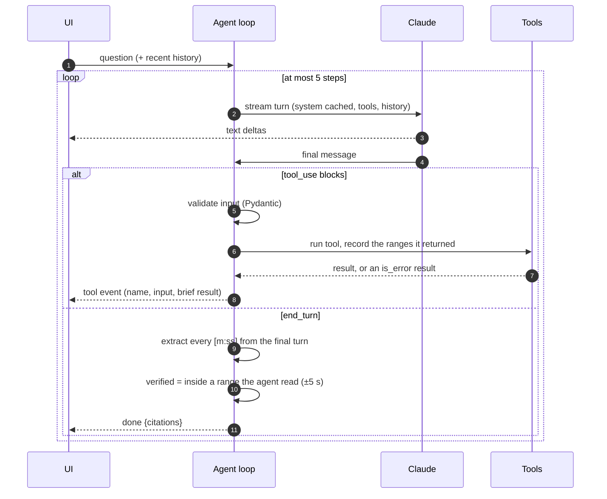

# Architecture

## Ingest pipeline

| Stage | What happens |
|---|---|
| **transcript** | **YouTube:** the link is parsed to a video id (watch, youtu.be, shorts, embed and live links; other hosts are rejected), captions come from `youtube-transcript-api`, and the title from the public oEmbed endpoint. **Upload:** PyAV decodes any audio or video to 16 kHz mono, then faster-whisper (`base.en`, int8, CPU, VAD on) produces timed cues. **Caption file:** WebVTT and SRT are parsed, styling tags dropped, and rolling auto-caption duplicates merged. |
| **index** | Cues are grouped into segments of `clamp(duration / 10, 12 s, 40 s)`, breaking at a pause or sentence end, hard-capped at 1.6x the target. Segments are embedded (bge-small via fastembed) into a `vec0` table partitioned by video, and into an FTS5 table with the Porter stemmer. |
| **summary** | The timestamped transcript (`[m:ss] text` per line) goes to Claude with a strict JSON schema: title, TLDR, vibe, chapters, moments, topics and suggested questions. |
| **verify** | Chapter starts snap to the nearest real line, are deduplicated, and are forced to begin at 0. Each moment's quote is searched within 45 seconds of the time the model gave, then across the whole video. It's pinned to the cue where the quote begins and marked `verified`. |

Stages are plain async functions run in order inside a background task. Every event goes to a replayable bus, so a page that reloads mid-ingest catches up.

### Finding a quote across caption breaks

Captions split sentences across lines, so each cue starts a window of the next four cues. Every window that begins at or before the quote, and reaches past it, contains the quote. The *latest* such window therefore starts at the cue where the quote begins. Matching runs on normalised text (case, punctuation, curly quotes), with a longest-common-run fallback of at least 85% for transcription differences.

## Chat agent

| Tool | Returns |
|---|---|
| `search_transcript(query)` | The top three hybrid hits, each with its range *and its individual timed lines*, so the agent can cite the exact line without a second call |
| `read_transcript(start, end)` | The exact lines between two times, capped at five minutes |
| `list_chapters()` | The verified chapters |

The tools are declared with `eager_input_streaming`. Because streamed inputs skip server-side validation, each input is validated before it runs. `max_tokens` with a pending tool call is never executed. Refusals end the loop.

## Players

- **YouTube** runs in a `youtube-nocookie.com` iframe with `enablejsapi=1`. Seeking posts `{"event":"command","func":"seekTo"}`. The current time arrives through `infoDelivery` messages after a `listening` handshake, accepted only from YouTube origins.
- **Uploads** play in a `<video>` element from `/api/videos/{id}/media`, which answers HTTP Range requests so seeking doesn't download the whole file. The transcript is also served as a WebVTT caption track.
- **Caption-only** videos have no player. Timestamps scroll the transcript instead.

## Limits

- Uploads are capped at 300 MB and videos at 180 minutes, and only known media and caption extensions are accepted.
- YouTube media is never downloaded, and there's no generic URL fetcher, so there's no server-side request forgery surface.
